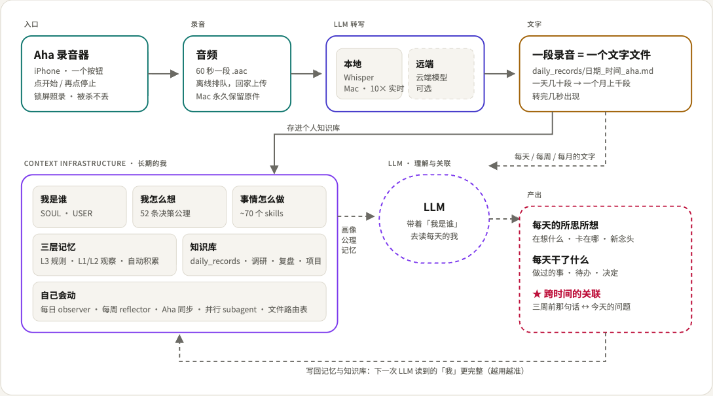
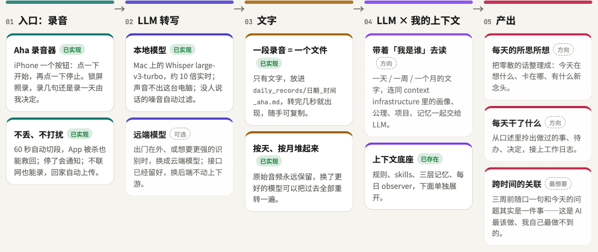
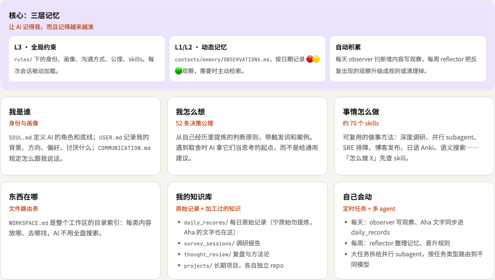

# Aha Moment

个人语音捕获基础设施：iPhone 后台持续录音（Ambient）或按住说话（Quick），音频切成 60 秒 AAC（ADTS，App 被杀也不丢）片段上传到自己 Mac 上的 FastAPI 服务，Mac 本地用 Whisper（mlx）转写，文字落在 `~/aha_data`。Quick 内容还会按前缀（待办 / 记一下 / 问 Claude）自动分发。

**和 context-infrastructure 联动**：本 repo 位于个人 AI workspace [context-infrastructure](https://github.com/shaorui0/context-infrastructure-template)（公开的是模板版） 的 `projects/aha_moment/` 下。**一段录音（手机上点一下开始、再点一下停止）= `contexts/daily_records/` 里一个纯文字文件** `YYYY-MM-DD_HHMM_aha.md`（HHMM 是开始时间，文件里只有转写文字）。由 workspace 的 cron（`periodic_jobs/aha_daily_record/run.sh`，14:50 / 23:55）生成；在录音列表点云朵主动上传的，转写完几秒内就出现。分工：

| 放哪里 | 内容 | 进 git 吗 |
|---|---|---|
| `~/aha_data/` | 原始音频、逐条转写（每段一个目录）、digest、inbox（todo/notes/优先转写） | 否（本机数据） |
| `context-infrastructure/contexts/daily_records/*_aha.md` | 每段录音一个文件，只有转写文字（ASR 原文，不经 LLM） | 否（`daily_records/` 已 gitignore） |
| 本 repo | 代码与文档 | 是（`shaorui0/aha-moment`，public） |

原则：audio 是 source of truth，transcript 是可重算的派生物；服务端 ACK 之前手机不删文件；transcript 永不覆盖（换模型 = 新增文件）。

## 为什么

- 一个入口：想到什么，手机或 Mac 上点一下就录，不用选分类、不用起名。
- 一个出口：结果都回到 `contexts/` 的文字文件、每晚的邮件和 App 的「面板」。
- 摩擦就是成本：每多一步操作，记录的次数就少一截，就像交易手续费决定了收益。所以录音之后的事全部自动。
- 入口和出口越少，信息越集中，LLM 才能跨时间把它们关联起来。

## 流水线（唯一事实来源）

| 段 | 输入 | 输出 | 脚本 / 服务 | 状态 |
|---|---|---|---|---|
| 录音 | 语音（iPhone / Mac 菜单栏 Ctrl+Shift） | 60s 分片 | `ios/`、`mac/AhaMac.swift` | 在用 |
| 上传与转写 | `PUT /v1/audio/{id}`（可带 `X-Aha-Tags: claude`） | `~/aha_data/…/transcript.*.txt` | `server/`、`asr/`（`com.aha.server`） | 在用 |
| 落成文字 | 转写 | `contexts/daily_records/D_HHMM_aha.md`（同分钟 `_aha-2.md`） | `pipeline/export_to_context.py` | 在用 |
| enhance（词表+纠错+标点分段+分类） | `*_aha*.md` + `pipeline/glossary.txt` + 个人知识库术语（topics.yml / catalog 高频 topic） | `daily_records/enhanced/<名>_aha.enhance.md`（task / thinking / diary / smalltalk） | `pipeline/correct_classify.py`（本地 Ollama） | 新，自动 |
| 语音任务合成 | `enhanced/*.enhance.md` 的 task/thinking 段 + 现有任务 + 负面清单 + topics.yml | `~/aha_data/inbox/tasks.json`（v2：title/next/area/topic/evidence/status；旧版备份 `tasks.v1.json`）；`GET /v1/tasks`、`POST /v1/tasks/{ack,dismiss,resynthesize}`、`POST /v1/tasks/{id}/to_claude`；App「Tasks」页按 工作/个人 → topic 展示，右滑推提醒事项、左滑删除、详情里可交给 Claude | `pipeline/synthesize_tasks.py`（Sonnet 无工具只吐 JSON；`nightly_digest/run.sh` 10:00 后每天一次）、`server/tasks.py` | 新 |
| 发给 Claude | Recordings 里点 ✨ 的录音 | `claude -p --model sonnet --name aha-<id>`，只写 OpenSpec proposal | `pipeline/claude_tasks.py`（`com.aha.dispatch`，每 2 分钟） | 新 |
| 日报 | `enhanced/`（缺失回退原文） | 每天 10:00 发前一天的邮件 | `periodic_jobs/nightly_digest/` | 在用 |
| 面板 | tracker、`claude_runs.jsonl`、日报文件 | App「面板」：Sessions / Tasks / Aha / 日报 | `server/claude_panel.py`、`server/digest.py` | 新 |

## 全景



实线是已经跑起来的，虚线是想做的方向。入口是一个只有一个按钮的录音器；说出来的话被模型转成文字，一天一天堆起来；这些文字再和 context infrastructure 里「我是谁、我怎么想、我在做什么」一起交给 LLM，整理每天的所思所想和做过的事，并找出跨时间的关联。完整页面：[docs/vision/architecture.html](docs/vision/architecture.html)（浏览器打开）。



Context Infrastructure 提供「长期的我」：



## 架构

```
iPhone (AhaMoment app, SwiftUI)             Mac (launchd 常驻)
┌──────────────────────────────┐            ┌────────────────────────────────────────┐
│ Ambient: 后台录音 -> 60s AAC │  HTTP PUT  │ com.aha.server  FastAPI :8765          │
│ Quick:   按住说话 -> 1 个片段│ ─────────▶ │  PUT /v1/audio/{id}  (sha256 + Bearer) │
│ 持久队列(ACK 前不删)         │ 同 Wi-Fi   │  POST /v1/quick  GET /v1/health        │
│ Recordings 页可回放          │ 或热点     │        │ worker: silero VAD -> mlx Whisper│
└──────────────────────────────┘            │  ~/aha_data/YYYY/MM/DD/<id>/           │
 (备选) iOS Shortcut -> POST /v1/quick      │     audio.aac meta.json                │
                                            │     transcript.<model>.txt/.json       │
                                            │  ~/aha_data/inbox/quick.jsonl          │
                                            │        │ com.aha.dispatch (每 2 分钟)  │
                                            │        v  todo.md / notes.md /         │
                                            │  cron 14:50/23:55 -> context-infrastructure│
                                            │   contexts/daily_records/D_HHMM_aha.md     │
                                            │           answers/<id>.md / unrouted.md│
                                            └────────────────────────────────────────┘
```

## 目录

| 路径 | 内容 |
|---|---|
| `server/` | FastAPI ingest（app.py / storage.py / worker.py / web.py）+ tests |
| `asr/` | `aha_asr` 可插拔 ASR（mlx_whisper 默认 / sensevoice / qwen3）+ bench |
| `mac/` | Mac 菜单栏录音器 `AhaMac.swift`（点麦克风图标或单按 Ctrl+Shift（修饰键 tap，需辅助功能权限）开始/停止，60s m4a 分片按 iPhone 协议 PUT 到本机 :8765，ACK 前留在 `~/.aha/mac_outbox`）；`./mac/build.sh` 编译安装到 `~/Applications` 并登录自启（LaunchAgent `com.aha.mac`） |
| `ios/` | SwiftUI App 源码、`project.yml`（XcodeGen）、`SHORTCUT.md`（无 Xcode 的快捷指令方案） |
| `pipeline/` | daily_digest / export_to_context / dispatch_quick + `routes.json` + launchd 模板 |
| `ops/` | `aha` CLI、`com.aha.server.plist`、`ios_reinstall.sh`、`backup.sh`、慢网装包脚本 |
| `e2e/` `tests/` | 端到端与单元测试 |
| `PLAN.md` | 设计与里程碑（保持原样） |
| `docs/` | 操作文档（见下） |

## 文档

按读者分两份入口：

| 读者 | 文档 | 内容 |
|---|---|---|
| **使用者**（想知道这是什么、怎么用） | [docs/user/index.html](docs/user/index.html)（浏览器打开） | 它解决什么问题、怎么运作、Ambient 与 Quick 两种用法、隐私边界、会收到哪些通知、常见问题、限制与路线图 |
| **开发者**（要改代码 / 扩展） | [docs/DEVELOPER.md](docs/DEVELOPER.md) | 架构与端到端数据流、不变量与契约、API 表、磁盘布局、iOS 状态机与看门狗、ASR 过滤层、开发与测试流程 |

部署与运维：

- [docs/SETUP_MAC.md](docs/SETUP_MAC.md)：新 Mac 从零部署（含 Xcode 安装路径）
- [docs/SETUP_IPHONE.md](docs/SETUP_IPHONE.md)：换新 iPhone 的逐步清单
- [docs/OPERATIONS.md](docs/OPERATIONS.md)：日常使用、启停服务、7 天重装、排障表
- 细节参考：`ops/INSTALL.md`、`asr/README.md`、`pipeline/README.md`、`ios/README.md`、`ios/SHORTCUT.md`

## 状态（2026-10-12）

**v1 完成，日常在用。** 一个按钮录音 → 60 秒 `.aac` 分片（被杀可救回）→ 回家自动上传 → Mac 本地 Whisper → 每段录音一个纯文字文件进 `contexts/daily_records/`（几秒内）。

| 待实测 | 怎么做 |
|---|---|
| 实际耗电（%/h） | 不插电连续录 1–2 小时，拉 `events.log` 的 battery 行，用 `docs/POWER.md` 里的脚本算 |
| 整晚长录 | 开着录一夜，第二天看分片是否连续 |
| cron 首次运行 | 14:50 后看 `/tmp/aha_daily_record.log` |
| 免费签名续期 | 2026-10-19 前插线跑 `ops/ios_reinstall.sh` |

Roadmap（未做）：LLM × context infrastructure 整理每天的所思所想 / 做过的事 / 跨时间关联（[全景图](docs/vision/architecture.html)的虚线部分）；离家实时上传（需个人设备做服务器）；Mac 会议系统音频采集（Core Audio Process Tap，已确认技术可行，暂缓）；真人语音 ASR 评测。

## 当前状态与限制

- v1 只走局域网：手机必须和 Mac 在同一网络（家里 Wi-Fi，或 Mac 连手机热点）才会上传；离开网络时片段在手机上排队，回网后自动补传。想在外面也能上传，可以自己配 Tailscale（见 `ops/INSTALL.md`）。
- 免费 Apple ID 签名每 7 天过期，需 USB 连接后运行 `ops/ios_reinstall.sh`（数据保留）。$99/年 开发者计划可解除。
- mDNS（`xxx.local`）在这台 Mac / 网络上不能解析，所以 App 里的 Backup 必须填 Mac 的局域网 IP，换网络要改。
- 来电 / Siri 打断后，iOS 通常不允许 App 在后台恢复麦克风，需要点通知或打开 App 才继续（会有录音空档）。
- `com.aha.digest`（每日摘要，`--llm` 会把转写发给 Claude API）默认不加载。
- 真人语音的 ASR 评测尚未做（bench 用的是合成语音）。
- 录音和转写都存在 Mac 本地（`~/aha_data`）；服务所在的机器能读到全部内容，请跑在你自己信任的设备上。
