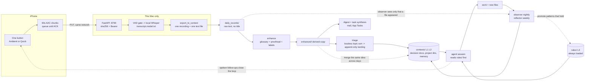

# Method: from a spoken sentence to session context

Aha Moment is the capture end of a personal context-engineering loop. The recorder is deliberately boring (one button). The method is everything after it: how a sentence becomes text, how text becomes organized knowledge, and how what survives becomes the starting context of the next agent session.

This document is the model. `README.md` (pipeline table) stays the single source of truth for what runs today; `docs/DEVELOPER.md` has the code-level contracts; `docs/REQUIREMENTS.md` says what the system must do and what may never enter the repo.

**中文要点**：这条链路不是「录音 -> 文字」，而是一个飞轮：说话 -> 本机转写 -> 一段一个文件 -> 整理（纠错、无损分主题、只追加落地）-> 记忆（L1/L2）与规则（L3）-> 下一个 session 一开始就读到 -> 干活 -> 每晚观测、每周反思 -> 站得住的 pattern 回灌规则。实线是已经在跑的，虚线是方向。

## 1. The flywheel

Solid arrows run today. Dashed arrows are direction (not built, or built but not measured).

What is solid and what is not:

| Link | Status | Note |
|---|---|---|
| button -> phone queue -> Mac -> Whisper -> `daily_records/` | running | v1, daily use |
| enhance (glossary, proofread, labels) | running, new | automatic, idempotent, derived copy |
| digest mail, task synthesis, App panel | running / new | read enhanced text only |
| triage: lossless topic sort -> append-only landing | running, manual | invoked on demand, because it costs tokens and writes the knowledge base |
| observer nightly, reflector weekly | running | observer sees new files, not their content |
| reflector -> `rules/` promotion | running in the reflector prompt | promotion rate is not measured yet |
| voice content -> L1/L2 through observer | direction | today voice reaches memory only via triage |
| merge the same idea across days | direction | nothing detects repeats yet |
| spoken follow-up closes the loop | direction | Quick tags dispatch tasks; no automatic reconciliation |

## 2. Invariants (hard rules)

A rule that nothing enforces is a wish. Each row names the enforcer.

| # | Rule | Why | Enforced by |
|---|---|---|---|
| I1 | Audio is the source of truth. A transcript is a recomputable derived artifact. | Any model error is fixable only if the input survives. | `server/storage.py` `add_transcript`; `aha reprocess` writes a new file |
| I2 | A transcript is never overwritten. A new model writes a new file. | Comparing models needs both outputs. | `add_transcript` skips an existing slug (`server/tests/test_server.py::test_reprocess_adds_second_file`) |
| I3 | The phone does not delete a chunk before the server ACK (200/201 with matching sha256). | A killed app or a dead network must not lose speech. | iOS `UploadQueue`; `test_upload_201_200_409_422` covers the server side |
| I4 | One recording is one file, and the file holds only text (no title, no front matter). Same minute gets `-2`. | Stable, greppable unit; nothing to maintain by hand; LLM steps cannot be confused by metadata. | `pipeline/export_to_context.py`; `pipeline/tests/test_export.py` (an invariants test is added in c0002) |
| I5 | One button is the only entry. No category, no title, no mode choice at capture time. | Friction is cost: every extra step lowers how often you record. | Convention, reviewed per change; no enforcer exists |
| I6 | LLM steps read enhanced or transcribed text only. They never read audio and never write the source. | Keeps the loop auditable and cheap; the observer by design ignores `daily_records/` content. | Pipeline code reads text files; the observer prompt |
| I7 | Silence never reaches the ASR. | Whisper hallucinates text on silence. | VAD gate in `asr/aha_asr` (`test_silent_skips_asr`) |
| I8 | Landing into the knowledge base is append-only and records where each line came from. | Mistakes stay visible and revertable. | `voice_topic_sort` (src comment on every fragment, coverage check); triage appends only |
| I9 | Personal data does not enter git: audio, transcripts, `daily_records/` content, employer identifiers. | The repo is public. | `.gitignore`; `python3 tools/check_rules.py` |
| I10 | Local first: transcription stays on this machine. Steps that need the network (proofread, mail) fail soft and retry next tick. | Privacy, and the capture path must never depend on a cloud. | Worker is local; pipeline tests `test_llm_down_defers_without_error`, `test_llm_failure_is_swallowed_and_retried_next_tick` |

## 3. How one utterance becomes context

| Step | Input | Action | Criterion (what makes it correct) | Artifact |
|---|---|---|---|---|
| 1 Capture | speech | one tap starts, one tap stops; chunks of 60 s are written so a kill loses at most the last frame | no chunk is lost; the user chose nothing | `queue/<id>.aac` + sidecar |
| 2 Upload | chunk | `PUT /v1/audio/{id}` with sha256 and Bearer token; retry with backoff; 409 goes to quarantine | server sha equals client sha; same id is idempotent | `~/aha_data/YYYY/MM/DD/<id>/audio.aac` |
| 3 Transcribe | audio | VAD gate, then local Whisper, then a hallucination filter | silent chunks produce no text; transcript file is new, never replaced | `transcript.<model>.txt/.json` |
| 4 Export | transcripts of one session | join chunks of one start-to-stop recording, in order | one recording gives one file; text only; stale files of our own pattern are removed, foreign files are left alone | `daily_records/D_HHMM_aha.md` |
| 5 Enhance | the raw file + glossary + personal terms | glossary replace, proofread, punctuation and paragraphs, label each paragraph task / thinking / diary / smalltalk | nothing summarized; uncertain edits are marked; original untouched | `daily_records/enhanced/*.enhance.md` |
| 6 Sort | enhanced files of a day | split into fragments, assign each to one or more topics, no compression | every fragment lands somewhere (coverage check); unsortable ones go to an `_unsorted` file | one markdown per topic with `src` markers |
| 7 Land | topic files | find the topic's home (decision doc, project dir, memory index), append, list todos and open questions for the user | append-only; each appended point cites its source; questions are never answered by the agent | appended lines, `*_actions.md`, a daily overview |
| 8 Observe | files changed in the last day | the nightly observer writes dated observations tagged by weight | only genuinely new content, not reformatting | L1 entries in the memory pool |
| 9 Reflect | the pool | the weekly reflector deletes the stale, merges the same topic, promotes what repeats | a promoted rule has more than one supporting event | L2 digest, and edits to `rules/` |
| 10 Start | `rules/` + memory index | every session reads L3 first and pulls L1/L2 by search | the starting context is the same files in the same order | the next agent session |

Open item on step 5: in this repository the committed contract is that enhance writes a derived copy and leaves the raw file alone. A revision in progress keeps the raw text under `raw/` instead. Whichever lands, I1 holds because the raw ASR text can always be rebuilt from `~/aha_data`.

## 4. Three layers of memory

| Layer | Holds | Written by | Read by | Promotion |
|---|---|---|---|---|
| L3 | constraints and identity: who the agent is, who it serves, communication rules, file routing, skill index | the human, plus the weekly reflector under review | every session, passively, before anything else | reached when a pattern repeats across weeks and survives a challenge |
| L2 | distilled themes and decisions, merged by topic | the weekly reflector (and triage, for decision documents) | agents on demand, by search over the pool | reached when the nightly entries on one topic accumulate |
| L1 | daily observations: what happened, what was decided, what broke and how it was fixed | the nightly observer | agents on demand | enters here when a file in the workspace is new and meaningful |

Voice text is raw material below L1. It becomes memory in two ways: (a) triage appends points to the decision document or project directory where that topic already lives; (b) the observer notices a new or changed file and records an observation about the work, not the sentence. Path (b) does not carry the sentence itself. That gap is why "voice -> L1/L2 by an explicit channel" is listed as direction in the requirements.

## 5. What this pipeline defends against

| Failure mode | What goes wrong | Defense | Where |
|---|---|---|---|
| A mistranscribed term enters the knowledge base | spec heard as spike, a product name heard as a common word; later searches miss it, an agent acts on the wrong word | glossary hard replaces, an `?` hint list the model judges by context, personal term list in the prompt; corrections are listed; topic sort keeps the original and only adds a margin note | `pipeline/glossary.txt`, `correct_classify.py`, `voice_topic_sort` |
| Information lost during classification | summarizing instead of sorting drops the detail that mattered | sort is lossless: every fragment copied verbatim with a source marker; coverage check proves each input fragment landed somewhere | `voice_topic_sort` |
| The LLM treats a diary as a task | a mood becomes a todo, noise pollutes the task list | per-paragraph labels, tasks synthesized only from task and thinking paragraphs, a negative list of rejected tasks, user acks and dismisses | `correct_classify.py`, `synthesize_tasks.py` |
| The same idea is recorded on several days with no merge | duplicates grow, the strongest signal (repetition) is invisible | not defended yet; direction R12 | requirements |
| Whisper hallucinates on silence | "thanks for watching" appears in a transcript | VAD gate before ASR, hallucination filter after | `asr/aha_asr` |
| A model upgrade silently skips reprocessing | changed filters but same slug, `reprocess` returns exists | filter version in the model slug (`+f2`) | `docs/DEVELOPER.md` 3.7 |
| An agent overwrites or rewrites history | wrong correction becomes the new truth | audio and transcripts immutable; landing is append-only with sources | I1, I2, I8 |
| A voice-triggered agent does damage | a mis-heard sentence runs a command | voice tasks are read-only on data, write only an OpenSpec proposal, a guard hook denies writes outside the workspace | `pipeline/claude_tasks.py`, `pipeline/hooks/voice_run_guard.py` |
| Private content leaks through the public repo | transcripts or employer names in docs, tests or reports | fixtures only; leak scan before every acceptance | I9, `tools/check_rules.py` |
| The loop silently stops | the nightly job fails and nobody notices | idempotent ticks with a pending state, `GET /v1/jobs` panel, daily mail | `periodic_jobs/nightly_digest`, `server/jobs.py` |

## 6. How this proves context engineering

It is not a recording app because the recorder is the least interesting part: the value is in what the next session starts with. Three properties make it context engineering rather than note-taking.

- **Rules are code, not habits.** The invariants above have enforcers (a hash check, a skip-if-exists, a test, a gitignore rule, a leak scan). When a rule has no enforcer (I5), the table says so.
- **Every session starts from a deterministic context.** `rules/` is always read first, in a fixed order; memory is pulled by search, not stuffed. What an agent knows at minute zero is a list of files, and you can print that list.
- **Accumulation is auditable.** Raw audio and transcripts are immutable, derived files can be deleted and rebuilt, and every appended line cites where it came from. If a belief in memory is wrong, you can follow it back to the sentence that produced it, or to the model that misheard it.

The flywheel closes when patterns that repeat are promoted into L3: then the thing you said in a train station changes how every later session begins.
